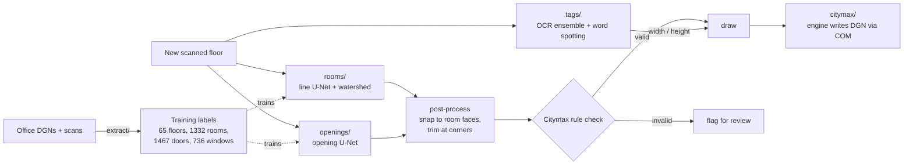

# scan2dgn

**Scanned floor plans → rule-valid MicroStation (Citymax) drawings, on one workstation, with no paid APIs.**

Each floor of a building project has to be redrawn from a scanned architectural plan into a MicroStation V8i DGN for
Citymax. The drawing contains every room boundary, every door and window opening with its width/height tag,
balconies, common areas and the floor outline. Today a person draws all of it by hand. The goal is about
15 projects a day with a person only reviewing: everything runs locally on one GPU, and no paid model APIs are used.

This repository is the automation side: data extraction, the trained networks, the rule checker, the tag reader
and the engine that writes into a live DGN.

## Pipeline



1. **Extraction** (`extract/`): opens *copies* of the office's own finished DGNs through MicroStation COM. It reads
   every room, opening, balcony and floor frame, then maps them into the pixels of the scanned sheet.
   - The finished drawings are the training labels. No hand labelling is needed.
   - Many old drawings contain mistakes, so a label audit (`rooms/gt_denetim.py`) scores each room outline
     against the ink in the scan. 856 of the 1332 rooms are clean, and the rest are ignored in training.
2. **Rooms** (`rooms/`): a U-Net predicts room-outline lines. A watershed then grows each room from its label point
   over the line probability.
3. **Openings** (`openings/`): a U-Net predicts door/window pixels, which `boxes3` turns into rectangles.
   - Post-processing (`aciklik_son.py`) snaps the long sides to the room faces and trims ends that would touch a
     wall corner.
   - The **rule checker** (`aciklik_kural.py`) decides whether each box is drawable.
4. **Tags** (`tags/`): door/window tags such as `90/210` and `K2 90/220` are found and read.
   - Readers: an ensemble of RapidOCR (4 rotations), docTR and Florence-2, plus **word spotting** (`esle.py`).
     Word spotting finds copies of a tag by image matching and votes on the number over all copies, so a tag
     that no OCR can read still gets the value of its look-alikes.
   - The reader never decides door vs window; it only gives a location and numbers.
   - A width that disagrees with the measured box rejects the read.
5. **Engine** (`citymax/`): writes rooms, openings and tags into the live DGN, then runs Citymax's own floor check.

## What "correct" means here

Distance-to-label metrics were rejected early, because many different drawings are valid. Instead:

**Openings** are judged by the Citymax rules, which give a min/max range rather than one right answer. A box is
valid when all of these hold:
- it touches or crosses exactly two areas (room, balcony, common area or floor outline);
- each of the two areas has one face that spans the box;
- no area vertex lies inside the box;
- no corner touches the box end. Citymax reports this as a "vertex error".

**Rooms** are scored on the boundary line itself (`rooms/sinir_skor.py`), not IoU. A room with the right area can
still have a wrong wall.

**Location metrics** are always reported next to a random-placement baseline (`tags/ocr_bench/yer_olc.py`). An
earlier "found within 0.6 m" metric scored the same as random and was thrown out.

**Held out:** one drawing family (Kışla) is never used for training, and one floor stays a fully blind final test.

## Results (23 Nov 2026)

### Openings, end to end

These are 5 held-out floors with 144 openings, drawn by a different office in a style the network never saw.

| Floor | Openings | Drawn and valid | Wrong boxes drawn | Height right (read + inferred) |
|---|---|---|---|---|
| Malkoç K2 (hand-labelled) | 40 | 38 | 3 | 26 + 6 |
| Kışla 85/1 | 40 | 37 | 2 | 36 + 1 |
| Kışla 84/1 | 29 | 26 | 3 | 19 + 3 |
| Kışla 85/Z | 9 | 7 | 0 | 6 + 0 |
| Kışla 84/Z | 26 | 22 | 6 | 14 + 3 |
| **Total** | **144** | **130 (90 %)** | **14** | **101 + 13** |

Opening net a5. The retrained net cut wrong boxes drawn from 20 to 14 against the previous net (a3), with the same
130 valid openings.

Location alone is 140/144.
- Most remaining "wrong boxes" are real openings that are missing from the reliable label set, or two pieces of
  one opening.
- The real junk is balcony railings.
- Median jamb error is 2.8–5.2 cm per floor.

### Tag reading

Tested on the Malkoç K2 hand label: 25 door and 15 window tags.

| Reader (crop around the opening) | Doors | Windows |
|---|---|---|
| RapidOCR | 6/25 | 0/15 |
| PP-OCRv5 server | 4/25 | 0/15 |
| PaddleOCR-VL-1.6 | 22/25 | 5/15 |
| GLM-OCR | 22/25 | 0/15 |
| MinerU2.5 | 20/25 | 0/15 |
| **OCR ensemble + word spotting (whole sheet)** | **25/25** | location 15/15 (random baseline: 1/15) |

The Malkoç window tags are not legible in the 1-bit scan at all. For these, word spotting gives the location, and
the floor majority of the same type and width gives the value, flagged as an inference.

On Kışla 85/1, word spotting found 25/29 doors and 9/11 windows.

### Rooms

| Floor (held out) | Line network | Previous room-area network |
|---|---|---|
| Kışla 85/1 | 0.864 | 0.842 |
| Kışla 84/1 | 0.778 | 0.601 |
| Kışla 85/Z | 0.773 | 0.728 |
| Kışla 84/Z | 0.747 | 0.582 |

Scores are the boundary score. With a perfect line map, the same room builder gets 92 of 93 rooms accepted, so the
line map is the remaining limit.

More tables are in [docs/RESULTS.md](docs/RESULTS.md). Approaches that failed are in [docs/LESSONS.md](docs/LESSONS.md).

## Repository layout

| Folder | What it does |
|---|---|
| `extract/` | `dgn_cikar.py`: DGN → elements via MicroStation COM, on copies only. `dgn_kat.py`: cut each floor out of the sheet scan and map labels into its pixels. |
| `rooms/` | Line U-Net (`cizgi_ag.py`), room builder (`cizgi_oda.py`), boundary score (`sinir_skor.py`), label audit (`gt_denetim.py`), floor outline (`kat_alani_uret.py`). Also the earlier piece-classifier networks (`bolut_*`, `parca_*`). |
| `openings/` | Opening net (`aciklik_ag3.py`), post-processing (`aciklik_son.py`), Citymax rule check (`aciklik_kural.py`), full chain (`aciklik_zincir.py`), variant comparison (`aciklik_karsilastir.py`), opening data from DGNs (`aciklik_veri.py`). |
| `tags/` | Tag finder net (`etiket_bulucu.py`), VLM reader (`etiket_oku.py`). |
| `tags/ocr_bench/` | Common test harness (`test2.py`), every OCR candidate, word spotting (`esle.py`), random baseline (`yer_olc.py`). |
| `citymax/` | Engine: writes into the live DGN and runs Kat Kontrol (`motor.py`, `native*.py`, `writer.py`). |
| `tools/` | `motor_cli.py`: engine command line. |
| `experiments/` | Archived experiments: local VLM agents (Qwen, DeepSeek), SAM, grounding and prompt tests. Kept for the record, not maintained. |

Code identifiers are partly Turkish: *oda* = room, *açıklık* = opening, *kapı* = door, *pencere* = window,
*etiket* = tag/label, *kat* = floor, *çizgi* = line, *sınır* = boundary, *kural* = rule, *zincir* = chain,
*eğitim* = training, *tahmin* = prediction, *son* = post-processing, *eşle* = match.

## Running

Data, model weights and drawings live outside the repository. Copy `config.example.json` to `config.local.json`
and point it at them, or set the `SCAN2DGN_*` environment variables (see `config.py`).

```bash
# environments (Windows, Python 3.12)
python -m venv .venv       && .venv/Scripts/pip install -r requirements/core.txt
python -m venv .venv-spec  && .venv-spec/Scripts/pip install -r requirements/nets.txt

# labels from the office's own drawings (MicroStation must be closed; originals are never opened)
.venv/Scripts/python extract/dgn_cikar.py
.venv/Scripts/python extract/dgn_kat.py

# train and run the opening net (one GPU: CUDA_VISIBLE_DEVICES=0)
A3_NIN=2 .venv-spec/Scripts/python openings/aciklik_ag3.py egit --tag a5 --steps 12000
A3_NIN=2 .venv-spec/Scripts/python openings/aciklik_ag3.py tahmin --tag a5 --kat kisla_85_1 --etiketsiz

# read the tags, then run the chain: boxes → rule check → widths/heights
.venv/Scripts/python tags/ocr_bench/a_rapid2.py kisla_85_1
.venv-spec/Scripts/python tags/ocr_bench/esle.py kisla_85_1
.venv/Scripts/python openings/aciklik_zincir.py kisla_85_1 --net a5
```

Hardware used: RTX 5070 Ti 16 GB for all compute (the display runs on a second card), and Windows 11 with
MicroStation V8i SELECTseries. One 12 000-step U-Net training takes about 65 minutes.

## Data policy

The scans and DGNs are real buildings belonging to clients, so **no drawings, scans, labels or weights are in this
repository** (see `.gitignore`). Results are reported as numbers only.

## Status and next steps

- **Done:** retraining the opening net (a5): no tag channel at training, class weight 1.5×, a separation seam
  between doors meeting at a corner, more negative crops. Junk boxes 45 → 29, end overshoot 2.5 → 1.1 cm.
- Balcony railings drawn as windows: the main source of wrong boxes on the unseen drawing style.
- End to end with predicted rooms: the chain is currently tested with labelled rooms; next it runs on the line
  network's rooms.
- Writing openings through the engine into the live DGN and closing the loop with Citymax's own floor check.
